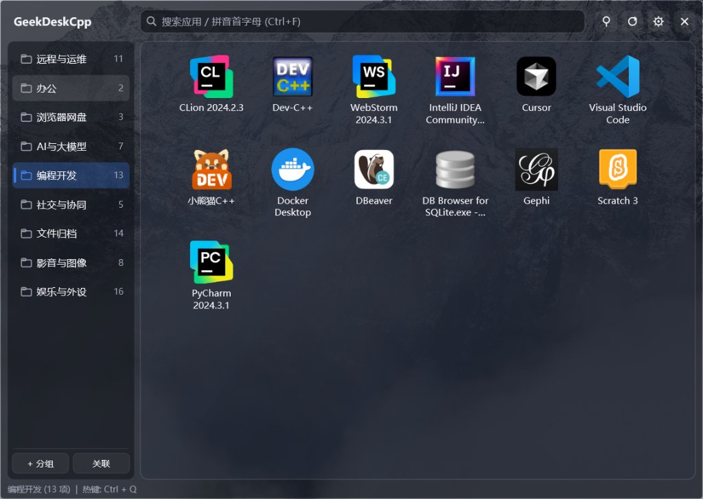

# GeekDeskCpp

> 🏛️ **[Ockham's Hunter Workshop · 奥卡姆的猎人工坊](https://github.com/OckhamsHunterWorkshop)** 出品  
> *"Fear the creeping bloat. Entia non sunt multiplicanda praeter necessitatem."*  
> 「 警惕蔓延的臃肿 —— 如无必要，勿增实体。」

**极简、原生、极致效率的 Windows 10/11 桌面快速启动器（C++20 + Win32 + Direct2D Software）。**  
*A minimal, ultra-fast native Windows 10/11 desktop launcher built with C++20, Win32, and Direct2D Software.*

> **设计哲学：做减法，少即是多。**  
> 砍掉动辄 110~330 MB 内存的 .NET/WPF 运行时、砍掉臃肿的 Everything 全盘检索与过时迁移包袱，只保留启动器最核心的 **毫秒级呼出、离线拼音直达、文件夹联动、Win10/Win11 统一分层视效与可靠的数据备份恢复**。



---

## 核心特性 / Highlights

- **原生零依赖单文件**：MinGW C++20 静态链接，单文件约 **2.79 MB**；无 `.NET`、无 `WebView2`、无 `Everything64.dll`、**0 MB 显存占用**（不加载 D3D11/DXGI GPU 用户态驱动）。
- **Win10 / Win11 统一分层合成（Mode A）**：采用 `WS_EX_LAYERED` + `UpdateLayeredWindow` + Direct2D Software（WARP），支持真实 **亚克力透明 (Acrylic)**、桌面壁纸模糊 **云母 / 深云母 (Mica / MicaAlt)**、自定义壁纸与渐变、`0~24 px` 抗锯齿圆角、卡片遮罩浓度，以及 **界面字体 / 字号** 实时调节。
- **桌面拖放收纳 & 统一自绘圆角菜单**：
  - 从用户桌面（含 OneDrive 桌面）或公共桌面拖入图标/文件时，自动识别来源并弹出轻量 2 项菜单（**移入独立收纳目录** 或 **仅建入口保留桌面**），批量拖入仅询问一次；
  - 物理文件经 Windows 原生 `IFileOperation` 按分组归纳（支持公共桌面提权确认与重名编号），后续软件内分组改名/跨组/移除均不删改原文件，并支持右键 **「移回桌面」**；
  - 左侧分组栏底部内置 **`+ 分组` / `关联`** 快捷按钮，支持无定时器跟手拖动排序（原位虚化 + 插入指示线 + 悬浮预览）；
  - 图标下方名称支持 **两行自动换行** 且保持整行图标严格水平对齐；
  - 分组右键、条目区右键与托盘右键全部采用统一深/浅色 Direct2D 圆角自绘菜单；条目右键「打开所在位置」通过原生 `SHOpenFolderAndSelectItems` 精确直达 `.exe` 真实位置；
  - 支持全局热键（默认 `Ctrl+Q`）与鼠标中键光标左上角对齐呼出、跨屏保持每行图标列数一致、工具栏按钮悬停文字提示。
- **中英双语界面 & 版本可见性**：支持简体中文 / English 实时切换；在设置页底部、托盘悬停、状态诊断、启动日志、`--version` 与 EXE 属性中均可直接查看当前版本与构建号。
- **离线内置拼音检索**：编译期嵌入 `U+4E00..U+9FA5` 汉字拼音表，支持全拼、首字母（含英文驼峰缩写如 `vsc` → `Visual Studio Code`）与高频权重排序。
- **Schema v1 无缝互通 & 一键状态诊断**：直接兼容 `GeekDeskNext` 的 `settings.json` 与 `catalog.json`；全量原子写入、每日快照、损坏自动恢复与 `.gdbackup` 单文件备份恢复；内置一键运行状态诊断与剪贴板报告导出。

---

## 实测资源与稳定性指标（Windows x64 Release）

| 检查项目 | 实测结果 |
| :--- | :--- |
| 单文件可执行体积 | `GeekDeskCpp.exe` 约 **2.79 MB**（`2,927,616` 字节） |
| 外部依赖审计（`objdump -p`） | 仅依赖 Windows 系统 DLL；**无** MinGW 运行时 DLL、**无** GPU 硬件用户态驱动、**无** `Everything*.dll` |
| 冷启动 + 首帧渲染（`--smoke-ui`） | **~92 ms**，Private Bytes **~11–12 MB**（Working Set ~25 MB） |
| 真实目录加载建索引（9 分组 / 78 条目） | **~15 ms** |
| 200 轮高强度压测（`--soak-test 200`） | GDI `63 -> 69`、USER `48 -> 49`、Handles `346 -> 346`、Private Bytes `13.94 MB -> 15.95 MB`（零泄漏） |
| 日常驻留使用（78 条目 + 图标缓存） | 私有内存约 **22–26 MB**，空闲 CPU **0%**，显存 **0 MB** |

---

## 下载与首次使用说明 / Quick Start

1. 前往 [Releases](../../releases) 下载最新的 `GeekDeskCpp-v*-win64-portable.zip`。
2. **解压到独立文件夹**（例如 `D:\Tools\GeekDeskCpp\`，请勿直接在压缩包内双击运行，以免同级 `data\` 目录无法写入）。
3. 双击 `GeekDeskCpp.exe` 启动（默认热键 `Ctrl+Q`，也可在屏幕任意位置点击鼠标中键呼出）。
   - **首次运行提示**：由于个人开源软件尚未购买商业代码签名证书，Windows 10/11 首次运行可能弹出 SmartScreen **“Windows 已保护你的电脑 / 未知发布者”**，点击 **「更多信息」→「仍要运行」**（*More info → Run anyway*）即可。可核对 Release 中附带的 `.sha256` 校验值确认文件完整。
4. **从 `GeekDeskNext` 迁移**：先退出 `GeekDeskCpp.exe`，将原 `GeekDeskNext\data\` 内的 `catalog.json`、`settings.json` 与 `assets\` 复制到 `GeekDeskCpp.exe` 同级 `data\` 目录即可。

---

## 本地构建与测试 / Build from Source

环境要求：Windows 10/11 x64，CMake >= 3.24，Ninja，MinGW-w64 UCRT (`g++` C++20) 或 MSVC。

```powershell
# 1. 配置与编译 Release 版本（-Wall -Wextra -Wpedantic -Werror 零警告）
cmake --preset mingw-release
cmake --build --preset mingw-release

# 2. 运行全部单元测试（doctest）
ctest --preset mingw-release --output-on-failure

# 3. 运行 Mode A 渲染烟雾测试 / 200 轮泄漏压测 / 只读数据校验
.\build\mingw-release\GeekDeskCpp.exe --smoke-ui --data-dir "<temp-data-dir>" | Out-Host
.\build\mingw-release\GeekDeskCpp.exe --soak-test 200 --data-dir "<temp-data-dir>" | Out-Host
.\build\mingw-release\GeekDeskCpp.exe --verify-data "<your-data-dir>" | Out-Host

# 4. 一键构建、审计、压测并生成便携发行包（输出至 dist\）
powershell -NoProfile -ExecutionPolicy Bypass -File .\scripts\package-release.ps1
```

---

## 致敬 / Acknowledgements
本项目的设计灵感致敬开源项目 [BookerLiu/GeekDesk](https://github.com/BookerLiu/GeekDesk)（基于 C++20 + Win32 + Direct2D 从零重写，聚焦极简与低内存占用）。
