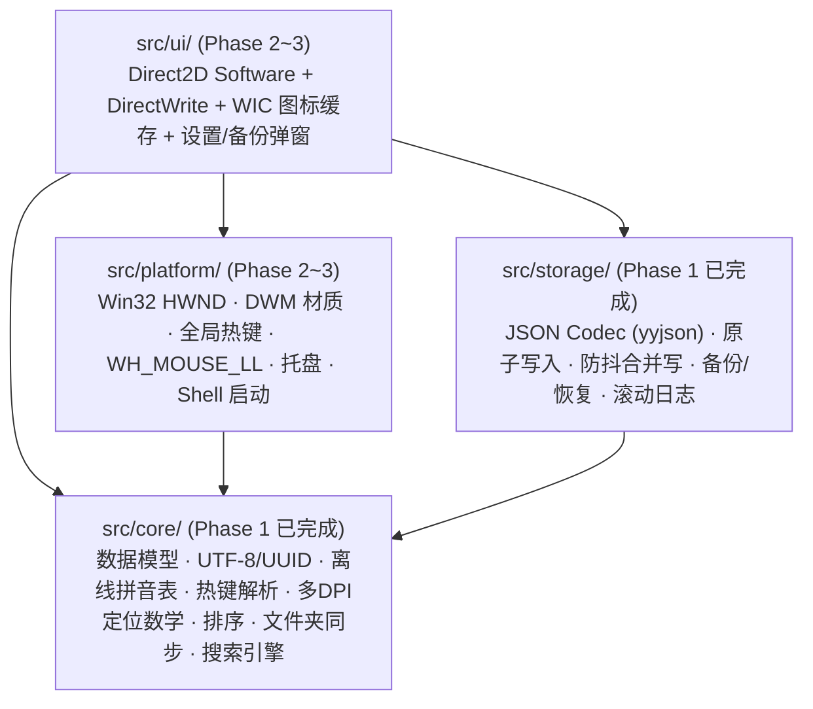

# 02 — 系统架构与 Mode A 渲染设计

## 1. 分层架构图



### 分层铁律
- **`src/core/`**：纯 C++20 逻辑与 Win32 纯数据 API（如 `CompareStringEx`、`MultiByteToWideChar`、`FindFirstFileExW`）。**禁止**创建窗口、渲染设备或读写全局配置路径。可直接被 `doctest` 无界面跑通。
- **`src/storage/`**：所有磁盘读写出口。禁止在 UI 逻辑中直接 `fopen` / `ofstream` 写入配置或目录文件；一切落盘必须经过 `WriteFileAtomic` 或 `DebouncedFileWriter`。
- **`src/platform/`**：封装 Win32 系统资源 RAII 句柄与消息钩子，通过轻量化回调或自定义 `WM_APP + N` 消息通知主窗口，不持有持久化状态。
- **`src/ui/`**：消费 `AppSettings` 与 `CatalogDocument` 的只读快照渲染界面，通过控制器/服务接口变更模型并触发异步持久化，不直接操作底层 JSON。

---

## 2. 线程模型（极简并发，杜绝竞态）

| 线程 | 职责 | 约束 |
| :--- | :--- | :--- |
| **UI 主线程（STA）** | `GetMessageW` 消息循环、Win32 窗口生命周期、热键/`WH_MOUSE_LL` 钩子消息、Direct2D Software 绘制、用户输入处理 | 严禁同步磁盘写入、严禁阻塞式扫描大量文件夹或网络路径 |
| **IO 防抖写线程（1 条，`DebouncedFileWriter`）** | 合并同一文件的短时间连续写入（默认 250ms 窗口），执行原子写盘；析构时强制同步冲刷 | 单线程串行落盘，天然避免同路径并发写锁冲突 |
| **Shell/图标后台工作线程（1 条任务队列）** | 异步提取 `SHGetFileInfoW` / `IShellItemImageFactory` 图标、裁切透明外框、编码 PNG 缓存到 `data/cache/icons/`、执行 `SyncLinkedFolderGroup` | 完成批次后通过 `PostMessageW(hwnd, WM_APP_ICON_READY, ...)` 通知 UI 线程重绘 |

---

## 3. Mode A 渲染管线设计（核心省内存关键）

### 为什么选 Mode A（DWM 原生材质 + Direct2D Software）？
传统 C++ 如果用 Direct3D11 + DXGI SwapChain + DirectComposition 渲染一个 820x520 的简单桌面面板，仅进程内加载 GPU 驱动、编译着色器、建立 D3D 设备上下文和离屏显存镜像就会带来 **40~100MB 以上的额外提交内存（Commit Size）**。

本方案采用 **Mode A**：
1. 窗口创建时启用 `WS_EX_NOREDIRECTIONBITMAP` 或常规分层/DWM 扩展玻璃框架（注意：`DwmExtendFrameIntoClientArea` + `DWMWA_SYSTEMBACKDROP_TYPE` 最稳妥的方案是使用**普通带 `DwmExtendFrameIntoClientArea(hwnd, {-1,-1,-1,-1})` 的 Win32 顶层无边框弹出窗口 `WS_POPUP`（非 `WS_EX_LAYERED` 全局静态位图）**，配合 `ID2D1DCRenderTarget` 预乘 Alpha 画布绘制，让 DWM 合成器在系统进程 `dwm.exe` 中免费提供 Acrylic/Mica/MicaAlt 实时模糊！）。
2. Direct2D 工厂创建参数仅使用软件路径：
   ```cpp
   D2D1_RENDER_TARGET_PROPERTIES props = D2D1::RenderTargetProperties(
       D2D1_RENDER_TARGET_TYPE_SOFTWARE,
       D2D1::PixelFormat(DXGI_FORMAT_B8G8R8A8_UNORM, D2D1_ALPHA_MODE_PREMULTIPLIED),
       0, 0, D2D1_RENDER_TARGET_USAGE_NONE, D2D1_FEATURE_LEVEL_DEFAULT);
   ```
   将渲染目标 `ID2D1DCRenderTarget` 绑定到 `BeginPaint` 的 `HDC`（或内存兼容 DC + `BitBlt` 双缓冲以消除闪烁）。
   > 注：在 Windows 10/11 上，`d2d1.dll` 内部执行 `D2D1_RENDER_TARGET_TYPE_SOFTWARE` 时会按需加载系统软件光栅器 `D3D10Warp.dll`（连带 `d3d11.dll`/`dxgi.dll` 接口壳），但**不会初始化任何硬件 GPU 用户态驱动**（实测私有提交内存 `Private Bytes` 仅约 **8.5 MB**）。
3. **透明通道（Premultiplied Alpha）合成规范（极其重要！）**：
   - DWM Backdrop 窗口要求客户端画布上的透明区域真正把 Alpha 写为 `< 1.0`。
   - **Wallpaper / Gradient 模式**：背景遮罩采用 `1.0` 全不透明绘制（先画壁纸/渐变，再叠加半透明暗色/亮色遮罩）。
   - **Acrylic / Mica / MicaAlt 模式**：
     - 首先用背景色调配合 `appearance.backgroundOpacity` 执行 `Clear(D2D1::ColorF(tintR, tintG, tintB, tintAlpha))`（例如亮色主题基准色白、暗色主题基准色深灰 `#18181B`，Alpha 取值随 `backgroundOpacity` 映射到可用可视区间，如 `0.15 ~ 0.90`，确保背景不透明度拖动条立竿见影地控制“透底程度”与“文字可读性”）。
     - 右侧内容面板与项目卡片必须基于**纯实色基色 × 有效 `cardOpacity`**（例如 `rgba(32,32,36, cardOpacity)` 或亮色 `rgba(255,255,255, cardOpacity)`），禁止复用原本就带 6% Alpha 的控件画刷再乘以 `cardOpacity`（那是此前 GeekDeskNext 滑动条无感的核心 Bug）。

---

## 4. 内存与图标缓存约束

1. **窗口隐藏即休眠**：窗口隐藏后立即停止任何悬停/滚动/渐变定时器，仅保留主窗口 HWND（免重复初始化）、配置与搜索索引。
2. **图标按需解码 + WIC PNG 持久化**：
   - 内存仅保留当前激活分组 + 高频常用条目的 `ID2D1Bitmap`（每张 `64x64 BGRA` 仅 16KB，100 个图标仅 1.6MB）。
   - 未激活分组切换后再懒加载，并在 LRU 容量超阈值（如 > 256 张内存位图）时释放冷分组位图，磁盘 `cache/icons/` 秒级重读。
3. **无高开销静态库**：使用 `yyjson`（单 `.c`/`.h`，解析 100KB JSON < 0.2ms）替代重型 C++ 模板 JSON 库；离线拼音表仅 ~100KB 只读 `.rdata` 段常量数组，零堆分配。
